<!--
  The cards in assets/ are regenerated every 6h by .github/workflows/profile.yml.
  Edit profile.config.json (text, facts, exclusions) — not the SVGs.
-->

<picture>
  <source media="(prefers-color-scheme: dark)" srcset="assets/header-dark.svg">
  
</picture>

  <a href="https://kampus.az"><b>kampus.az</b></a>
  <!-- &nbsp;·&nbsp; <a href="https://www.linkedin.com/in/YOUR-HANDLE">LinkedIn</a> -->

<picture>
  <source media="(prefers-color-scheme: dark)" srcset="assets/stats-dark.svg">
  
</picture>

<picture>
  <source media="(prefers-color-scheme: dark)" srcset="assets/activity-dark.svg">
  
</picture>

<picture>
  <source media="(prefers-color-scheme: dark)" srcset="assets/code-dark.svg">
  
</picture>

cards rendered by <a href="scripts/render.mjs">a small script</a> in this repo · refreshed every 6h by GitHub Actions · designed with Claude

