<!--
  The cards in assets/ are regenerated every 6h by .github/workflows/profile.yml.
  Edit profile.config.json (text, facts, timezone, exclusions) — not the SVGs.
-->

<picture>
  <source media="(prefers-color-scheme: dark)" srcset="assets/header-dark.svg">
  
</picture>

<p align="center">
  <a href="https://kampus.az"><b>kampus.az</b></a> &nbsp;·&nbsp;
  <a href="https://www.linkedin.com/in/aligulmaliyev/">LinkedIn</a> &nbsp;·&nbsp;
  <a href="mailto:ali.gulmaliyew@gmail.com">Email</a>
</p>

<picture>
  <source media="(prefers-color-scheme: dark)" srcset="assets/stats-dark.svg">
  
</picture>

<picture>
  <source media="(prefers-color-scheme: dark)" srcset="assets/streak-dark.svg">
  
</picture>

<picture>
  <source media="(prefers-color-scheme: dark)" srcset="assets/activity-dark.svg">
  
</picture>

<picture>
  <source media="(prefers-color-scheme: dark)" srcset="assets/rhythm-dark.svg">
  
</picture>

<picture>
  <source media="(prefers-color-scheme: dark)" srcset="assets/code-dark.svg">
  
</picture>

<details>
<summary><b>⚛️ about me — as a TypeScript object</b></summary>
<br>

```ts
const ali = {
  name: "Ali Gulmaliyev",
  role: "Lead Frontend Engineer @ ABB",
  location: "Baku, Azerbaijan",
  frontend: ["React", "Next.js", "TypeScript", "Tailwind CSS", "Vite", "Zustand", "React Router"],
  backend: ["Java", "Spring Boot", "NestJS", "Camunda", "Microservices"],
  delivery: ["ArgoCD", "Snyk"],
  ai: ["Claude", "LiveKit"],
  building: ["kampus.az", "real-time AI voice avatar"],
  openTo: ["relocation"],
} satisfies Engineer;
```

</details>

<details>
<summary><b>🛠 what I'm building</b></summary>
<br>

| | |
|---|---|
| **[kampus.az](https://kampus.az)** | Management SaaS for private tutors and tutoring centers — question bank, online exams with proctoring, homework, schedule, attendance and a parent portal. |
| **AI voice avatar** | A real-time AI voice avatar for banking customer guidance, built on LiveKit. |

</details>

<p align="center"><sub>cards rendered by <a href="scripts/render.mjs">a small script</a> in this repo · refreshed every 6h by GitHub Actions · designed with Claude</sub></p>
